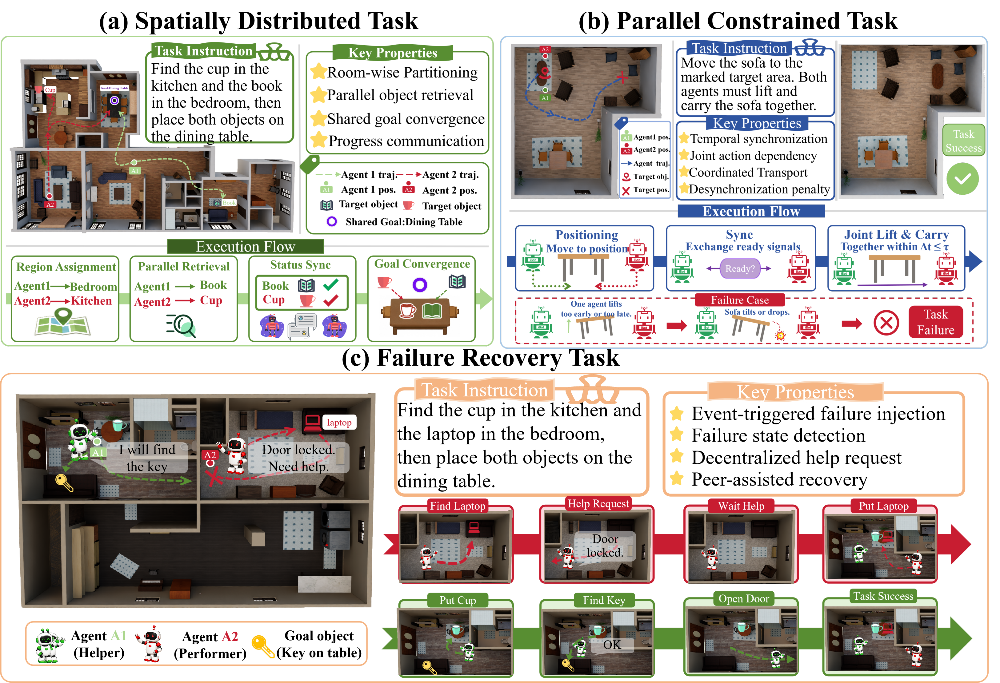

# CoEmbod: A Long-Horizon Benchmark for Multi-Agent Embodied Cooperation with Diverse Inter-Agent Dependencies


## Overview

Embodied agents are expected to perceive, reason, and execute long-horizon tasks in physical environments. However, existing embodied benchmarks mainly focus on single-agent execution or limited multi-agent scenarios, leaving realistic cooperation with complex inter-agent dependencies underexplored.

We introduce **CoEmbod**, a realistic 3D simulated benchmark for evaluating long-horizon multi-agent embodied cooperation.

CoEmbod contains:

- **155 expert-curated tasks**
- **40 realistic 3D scenes**
- **10,845 object instances**

covering three cooperation regimes:

- Spatial Distribution
- Parallel Constraint
- Failure Recovery


## Benchmark Overview




## Key Features

### Diverse Cooperation Dependencies

CoEmbod evaluates multiple forms of inter-agent dependencies, including distributed task allocation, synchronized execution, and adaptive failure recovery.


### Process-Level Evaluation

We introduce **Budgeted Cooperative Success (BCS)**, a process-level metric that jointly evaluates:

- goal completion
- cooperation fidelity
- execution efficiency


## Results

Current multimodal agents still struggle with long-horizon cooperation.

The strongest evaluated model achieves only **28.6% success rate**, revealing substantial challenges in coordination, synchronization, and recovery.


## Code and Data

🚧 **Code and benchmark data are coming soon.**

Please stay tuned.


## Citation

If you find CoEmbod useful, please cite:

```bibtex

@inproceedings{dong2026coembod,
  title={CoEmbod: A Long-Horizon Benchmark for Multi-Agent Embodied Cooperation with Diverse Inter-Agent Dependencies},
  author={Dong, Xuan and Han, Zhe and others},
  booktitle={EMNLP},
  year={2026}
}
